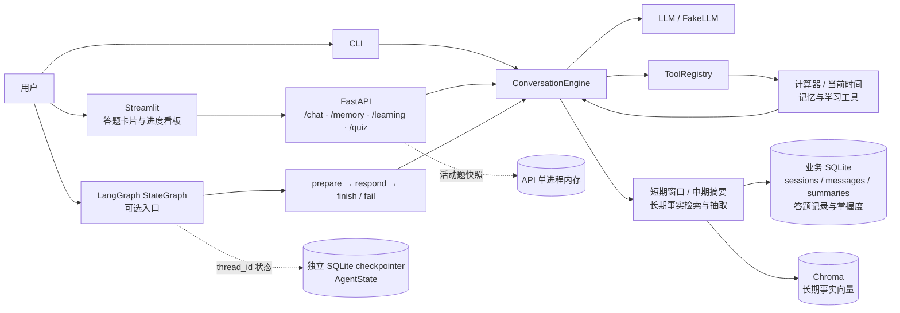
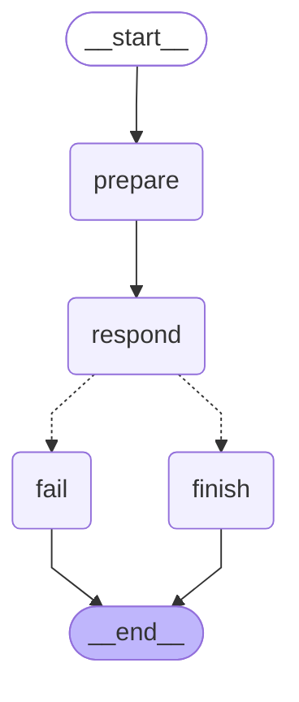

# 有记忆的私人助理 Agent

> 一个会**真正记住你**的 AI 助手。
>
> 它实现了分层记忆、模型工具调用，以及计算器、当前时间和学习教练工具。
> 项目已完成 D1–D21：包含分层记忆、工具调用、LangGraph 编排、学习教练、离线策略评测、FastAPI 与 Streamlit。Docker Compose 配置已提供，容器构建和运行仍待在装有 Docker 的环境验证。

---

## 当前进度

| 单元 | 内容 | 测试 | 状态 |
|---|---|---|---|
| **D1** | `ShortTermMemory`（滑动窗口 + token 预算） | 19 | ✅ 已完成 |
| **D2** | `SummaryMemory`（中期递归摘要） | 42 | ✅ 已完成 |
| **D3** | `LongTermMemory`（集合、事实写入与读取） | 基础用例通过 | ✅ 已完成 |
| **D4** | `LongTermMemory`（三因子评分、去重与失效） | 51 | ✅ 已完成 |
| **D5** | `FactExtractor`（结构化输出 + 健壮解析） | 57 | ✅ 已完成 |
| **D6** | 四层记忆集成 + 离线 CLI 验证 | 2 | ✅ 已完成 |
| **D7** | 真实模型多轮对话 + 跨会话记忆验证 | live | ✅ 已完成 |
| **D8** | 工具注册框架 + 计算器 / 当前时间 + 有界工具循环 | 15 | ✅ 已完成 |
| **D9** | 学习记录、掌握度追踪 + 薄弱知识点查询 | 10 | ✅ 已完成 |
| **D10** | 按需长期记忆检索工具 + 重复调用上限验证 | 7 | ✅ 已完成 |
| **D11** | LangGraph `StateGraph` + 节点 + 条件边 | 6 | ✅ 已完成 |
| **D12** | SQLite checkpointer + 跨图实例状态恢复 | 新增 2（图测试共 8） | ✅ 已完成 |
| **D13** | 端到端回归 + 导出架构图 | 新增 2（集成测试共 4） | ✅ 已完成 |
| **D14** | 缓冲 + M2 里程碑验收 | 全量回归、工具/图/架构图检查 | ✅ 已完成 |
| **D15** | 用户画像 + 规则版冲突消解 + 多用户隔离 | 7 项专项用例；相关定向回归 151 passed | ✅ 已完成 |
| **D16** | 掌握度更新 + 简化 SM-2 间隔复习调度 | `test_learning.py` 13 项定向用例 | ✅ 已完成 |
| **D17** | 自适应出题 + 苏格拉底式追问 + `/quiz` | `test_quiz.py`、`test_learning.py`、`test_engine.py` 共 62 passed | ✅ 已完成 |
| **D18** | 最小版评测 + 已知局限说明 | `scripts/evaluate_adaptive_quiz.py`；固定种子离线对照 | ✅ 已完成 |
| **D19** | FastAPI + SSE 对话与记忆查询 | `POST /chat`、`GET /memory`；用户/会话隔离 | ✅ 已完成 |
| **D20** | Streamlit 答题界面 + Docker | 答题卡片、学习看板、Compose 配置 | ✅ 已完成（容器构建待 Docker 环境验证） |
| **D21** | 文档与交付收尾 | README、项目介绍提纲、运行说明与已知边界 | ✅ 已完成 |

测试验证记录（截至 2026-10-13；历史全量基线单独标注）：

- D15 后的历史全量基线：**318 passed，4 skipped**（共 322 条；离线运行），只作为历史记录。
- D20 本轮全量测试：**333 passed，4 skipped**（共 337 条；`PYTHON_DOTENV_DISABLED=true`，未读取 `.env`、未调用真实 API）。
- D16 定向测试：`tests/test_learning.py` **13 passed**（离线运行）。
- D17 定向测试：`tests/test_quiz.py tests/test_learning.py tests/test_engine.py` **62 passed**（离线运行）；未调用真实 API。
- D19 定向测试历史结果：`tests/test_api.py` **4 passed**（FakeLLM、FakeEmbeddings、临时 SQLite；未调用真实 API）。
- D21 为文档收尾，没有修改运行时代码或重跑测试；本轮核对 README 与代码现状，并运行离线 token 预算实验。
- D1 短期记忆：**19/19 通过**
- D2 中期摘要：**42/42 通过**
- D3 长期记忆基础层：集合初始化、事实写入、按 ID 读取和基础检索已完成
- D4 长期记忆增强层：三因子评分、时间衰减、命中加权、去重、失效与删除已完成（51/51）
- D5 事实抽取：prompt 构造、健壮 JSON 解析、置信度过滤、批内去重与异常保护已完成（57/57）
- 已就绪基础设施：SQLite 存储 **39/39**、对话引擎 **44/44**、向量层 **20/20**（另有 4 条真实模型慢测默认跳过）
- D6 集成验证：真实 SQLite、Chroma、四个记忆模块与对话引擎协同通过；`--fake` 中文 CLI 流程通过
- `--fake` 使用 FakeLLM + FakeEmbeddings，离线运行但仍走真实记忆写入、检索和摘要路径
- D7 真实 API 验证：运行 `python scripts/verify_live_memory.py --cache-dir data/models`，会产生模型 API 用量，并将数据写入独立的 `data/d7-live-check`；假向量验证使用独立集合
- D7 已实测通过：DeepSeek Flash 完成 20 轮对话；真实 BGE embedding 命中长期姓名事实；重建引擎后成功回答姓名
- D8 工具框架：OpenAI 兼容函数 schema、白名单注册与执行；计算器安全解析基础四则运算；当前时间返回本地时区偏移；工具调用循环有轮数上限
- D8 的离线验收覆盖计算器 `123*456 = 56088`、模型收到工具结果后生成最终答复，以及“现在几点”触发时间工具；无需 API Key
- D9 学习教练：schema v1→v2 迁移新增 `topics` / `attempts` / `topic_mastery`；`record_answer` 持久化答题并更新掌握度，`get_weak_topics` 按掌握度返回当前用户的薄弱点；两工具通过引擎和 FakeLLM 完成离线往返验证
- D9 当前掌握度规则：初始值 0.3；答对按 `(1-mastery)*0.3` 增长，半对按 `(1-mastery)*0.15` 增长，答错减半；低于 0.4 返回为薄弱点
- D10 `recall_memory`：模型可在当前上下文没有明确答案时按需搜索长期记忆；`user_id` 由引擎绑定，查询参数校验；FakeLLM 验证工具往返和重复调用触发上限。它补充每轮已有的记忆注入，不替代该检索路径
- D11 LangGraph：新增 `memory_assistant.graph`，用 `StateGraph` 把 `prepare → respond → finish/fail` 编排成一轮对话；支持注入现有 `ConversationEngine` 或测试 responder，并可用 `graph.get_graph().draw_mermaid()` 导出拓扑
- D12 SQLite checkpointer：`build_graph(..., checkpointer=saver)` 按 `thread_id` 持久化 LangGraph `AgentState`；关闭并重建 saver 和图后仍能接续消息。它保存的是图状态，不替代 `ConversationEngine` 使用的会话、摘要和长期事实存储
- D13 端到端回归：集成真实 `ConversationEngine`、工具、SQLite/Chroma 记忆与 SQLite checkpointer，离线验证计算器调用、事实跨重启检索、消息不重复落库，以及工具轮次失败后继续对话；架构图见下方，可用 `python scripts/export_graph.py` 从当前图实现重新导出
- D14 M2 验收：工具调用、LangGraph 图运行和架构图导出均有测试或命令验证；全量测试保持 311 passed、4 skipped
- D15 用户画像与多用户隔离：SQLite schema v3 为会话补充 `user_id`；画像按用户存为 JSON；长期事实写入时先执行原有去重，再对同一用户、同一 `subject + predicate` 的不同值标记旧事实失效。CLI 支持 `--user <id>` 和 `/user <id>`；Alice/Bob 的会话、摘要、事实、画像及记忆工具均按用户隔离；151 项定向回归和全量离线回归（318 passed、4 skipped）通过
- D16 学习调度：答对后连续正确次数决定间隔（1 天、3 天，之后乘当前 ease）；答错或半对会重置为 1 天并降低 ease；`get_due_reviews` 和 CLI `/due` 只返回当前用户已到期知识点。D16 的 13 项学习定向测试通过，未调用真实 API
- D17 自适应答题：`/quiz [知识点]` 通过到期复习和薄弱知识点选择题目；首次答错只给小提示并要求重试，第二次仍错才给完整解释；每次判题都经由当前用户绑定的 `record_answer` 保存。定向测试 `tests/test_quiz.py tests/test_learning.py tests/test_engine.py` 为 62 passed，未调用真实 API。
- D18 离线选题评测：`scripts/evaluate_adaptive_quiz.py` 用 20 条合成答题历史建立 11 个知识点快照，固定 seed `20261013` 比较随机基线和当前 `AdaptiveQuiz.start()`；随机基线薄弱覆盖率为 9/20（45%）、已掌握知识点无效出题率为 7/20（35%），自适应策略为 20/20（100%）和 0/20（0%）。这只评估选题策略，不是题目质量、答题准确率或真实用户效果。
- D19 FastAPI：`POST /chat` 通过 SSE 返回 `meta`、`token`、`done` 或 `error`；`GET /memory` 返回用户画像、当前查询的有限相关事实命中，以及指定或最近会话的摘要/近期消息。传 `session_id` 可恢复会话；跨用户会话访问被拒绝。`user_id` 仅为数据分区字段，没有认证。默认工具调用路径的答复目前在完成后以单个 `token` 事件发送，不是模型级逐 token 流式。
- D20 Web UI：Streamlit 通过 FastAPI 提供自适应答题与学习进度看板；活动题状态只保存在 API 单进程内，未完成题会在 API 重启后丢失。Compose 编排文件已写好，容器尚未实际构建或运行。
- D21 文档收尾：README、启动说明、评测数据和已知边界已按当前实现核对；Docker 实机验证仍待安装 Docker 后完成。

已就绪的基础设施：

- 配置管理、DeepSeek 客户端（含离线假模型 `FakeLLM`）、环境自检脚本
- SQLite 持久化层（`Database` + `Store`）—— 39 个测试
- 向量层（本地中文 BGE 模型 + 假向量模型）—— 20 个快速测试
- 对话引擎 + 命令行界面（依赖注入设计，可脱离记忆模块单独测试）—— 44 个测试

> 向量模型的选型有实测数据支撑，见 [记忆架构设计 · 第 12 节](docs/记忆架构设计.md#12-向量模型选型实测记录)

## 当前架构

下面描述当前代码中已经实现的运行关系。CLI、FastAPI 和 Streamlit 都复用 `ConversationEngine` 的业务逻辑；Streamlit 通过 FastAPI 读取学习进度并发起/提交题目。API 的活动题快照仅保存在进程内存，答题结果和掌握度写入业务 SQLite。



LangGraph 实际节点拓扑由代码导出如下：



源图文件位于 [`docs/diagrams/conversation_graph.mmd`](docs/diagrams/conversation_graph.mmd)，重新导出命令为 `python scripts/export_graph.py`。

---

## 这个项目解决什么问题

大模型本身**没有记忆**。它是无状态的：每次请求你都得把之前的对话重新发一遍。

于是产生两个致命问题：

| 问题 | 后果 |
|---|---|
| 历史全量塞回去 | token 爆炸、成本飙升、最终超出上下文窗口 |
| 只塞最近几轮 | 忘了用户是谁、忘了重要偏好，"每次都像在跟陌生人说话" |

主流产品的做法是简单粗暴地「保留最近 N 轮」，信息损失很大。
本项目做了更细的分层：**该记住的记住，该压缩的压缩，该忘的忘掉。**

---

## 核心设计：四层记忆

| 层次 | 存什么 | 技术方案 | 解决的问题 |
|---|---|---|---|
| **短期** | 最近几轮原文 | 按 token 预算裁剪的滑动窗口 | 对话连贯性 |
| **中期** | 更早对话的摘要 | LLM 递归增量压缩 | 上下文窗口限制 |
| **长期** | 抽取出的结构化事实 | 向量检索 + 时间衰减 | 跨会话记住细节 |
| **画像** | 姓名/职业/偏好/禁忌 | 结构化 JSON，增量合并 | 稳定、便宜、可控 |

**不只是"存进去"，还包括：**

- **抽取**：从对话里自动识别值得记住的事实（`subject-predicate-object` 三元组）
- **去重**：相似事实合并，累加命中次数而不是重复存储
- **冲突消解**：同一用户、同一主体和谓词出现不同值时，规则版标记旧事实失效；不调用 LLM
- **遗忘**：时间衰减 + 低频淘汰 + TTL，防止向量库无限膨胀
- **配额**：显式的 prompt token 预算表，保证输入永不失控

---

## Token 预算分配

每次请求的输入 token 都受这张表约束，超出配额就按优先级裁剪：

| 组成部分 | 预算占比 | 超预算时的处理 |
|---|---|---|
| 系统提示词 | 10% | 固定，不可压缩 |
| 用户画像 | 10% | 字段按重要性排序，从低到高砍 |
| 长期记忆 | 20% | 按综合分数取 top-k |
| 中期摘要 | 20% | 过长时按 token 上限截断并加省略号 |
| 近期对话 | 40% | 从最老的开始丢弃 |

---

## 技术栈

| 层 | 选型 |
|---|---|
| 语言 | Python 3.12 |
| 大模型 | DeepSeek（OpenAI 兼容接口） |
| 编排 | LangGraph（StateGraph + Checkpointer + Store） |
| 结构化输出 | pydantic |
| 向量库 | Chroma |
| 关系存储 | SQLite |
| 后端 | FastAPI（SSE 流式） |
| 前端 | Streamlit |
| 部署 | Docker + docker-compose |
| 测试 | pytest |

---

## 快速开始

```powershell
# 1. 进入项目目录
cd D:\Agent开发

# 2. 创建虚拟环境并安装依赖
python -m venv .venv
.\.venv\Scripts\python.exe -m pip install -r requirements.txt
.\.venv\Scripts\python.exe -m pip install -e . --no-deps   # 把本项目装成可导入的包

# 3. 配置密钥
Copy-Item .env.example .env
#    然后用编辑器打开 .env，填入你的 DEEPSEEK_API_KEY
#    申请地址：https://platform.deepseek.com/api_keys
#    默认模型是 deepseek-flash；旧的 deepseek-chat 兼容名目前也会路由到 flash。
#    如需确认实际路由，运行环境自检，或查看 DeepSeek 后台的用量记录。

# 4. 环境自检（以后遇到任何问题，第一件事就是跑它）
.\.venv\Scripts\python.exe scripts\check_env.py

# 5. 第一次调用大模型
.\.venv\Scripts\python.exe scripts\step0_hello_llm.py

# 6. 开始对话
.\.venv\Scripts\python.exe scripts\step1_chat_cli.py

# 7. 运行测试
.\.venv\Scripts\python.exe -m pytest tests/ -v
```

> ⚠️ 所有 `python` 命令都要用 `.\.venv\Scripts\python.exe`，不要用全局的 `python`。
> 否则会提示找不到 `openai` 模块。

---

### 启动网页答题界面（D20）

先在一个 PowerShell 窗口启动 API：

```powershell
cd D:\Agent开发
.\.venv\Scripts\python.exe -m uvicorn memory_assistant.api:app --host 127.0.0.1 --port 8000
```

再开第二个窗口启动 Streamlit：

```powershell
cd D:\Agent开发
.\.venv\Scripts\python.exe -m streamlit run app.py
```

浏览器打开 `http://localhost:8501`。真实答题会调用 `.env` 里配置的模型 API；首次向量检索可能下载中文 embedding 模型。界面展示当前用户已练习知识点的掌握度、薄弱与到期计数，支持自动选题或指定知识点，并复用 D17 的“首次提示、第二次解释”流程。

也可以从项目目录用 Docker Compose 一键启动 API 与网页：

```powershell
docker compose up
```

网页地址为 `http://localhost:8501`，API 文档地址为 `http://localhost:8000/docs`。Compose 通过运行时环境传递模型设置，并用命名卷保存 SQLite、Chroma 和 embedding 缓存。首次构建会安装 Python 依赖，首次模型使用还可能需要网络下载 BGE。执行 `docker compose down` 会停止服务；不要加 `-v`，否则会删除持久数据卷。

尚未安装 Docker 的 Windows 用户可以在 **WSL2 中验证容器**。建议先安装 Docker Desktop，启用 WSL2 引擎，并在 Settings → Resources → WSL Integration 中启用所用的 Linux 发行版。安装完成后，在 WSL 终端进入项目目录并运行：

```bash
cd "/mnt/d/Agent开发"
docker --version
docker compose version
docker compose up --build
```

看到 `api` 和 `ui` 服务保持运行后，在 Windows 浏览器访问 `http://localhost:8501` 和 `http://localhost:8000/docs`；也可另开 WSL 终端运行 `docker compose ps` 查看服务状态。首次构建需要下载依赖，首次使用真实向量模型还可能下载 BGE。没有配置 `DEEPSEEK_API_KEY` 时可以检查镜像构建、容器启动和页面/API 文档可访问性；学习看板和真实答题请求会因 API 引擎要求模型 Key 而失败。配置 Key 后再验证完整答题流程。验证结束运行 `docker compose down` 停止服务，不要加 `-v`，以保留数据卷。

答题状态只缓存在 API 单进程内；重启 API 会清除未完成题目。当前配置适合单进程本地使用，不支持多 worker 间共享活动题，也没有身份认证。

### D19 API 手动测试

在项目目录打开一个 PowerShell 窗口启动服务：

```powershell
.\.venv\Scripts\python.exe -m uvicorn memory_assistant.api:app --host 127.0.0.1 --port 8000
```

服务启动后，在另一个 PowerShell 窗口请求对话。若未传 `session_id`，先从 `meta` 事件复制返回值，再带上它继续同一会话：

```powershell
curl.exe -N http://127.0.0.1:8000/chat -H "Content-Type: application/json" -d '{"message":"我喜欢深色主题","user_id":"alice"}'
curl.exe -N http://127.0.0.1:8000/chat -H "Content-Type: application/json" -d '{"message":"你记得我的主题偏好吗？","user_id":"alice","session_id":"替换成上一步的 session_id"}'
Invoke-RestMethod "http://127.0.0.1:8000/memory?user_id=alice" | ConvertTo-Json -Depth 6
```

运行时需要在 `.env` 配置可用的模型 API Key，首次使用真实向量模型时可能需要下载模型；手动发起 `/chat` 会调用配置的模型服务。SSE 事件名为 `meta`、`token`、`done` 或 `error`。当前工具调用路径在最终答复完成后才调用引擎回调，因此完整答复作为一个 `token` 事件发送；本单元完成了 SSE 接口，但尚未实现模型级逐 token 输出。`user_id` 只用于数据分区，不是登录或身份认证。

## 目录结构

```
learn-coach-agent/
├─ README.md
├─ requirements.txt
├─ Dockerfile                   ← D20 Python API/UI 镜像
├─ docker-compose.yml            ← D20 API + Streamlit 一键启动
├─ app.py                        ← D20 Streamlit 答题与学习进度看板
├─ .dockerignore                 ← 排除密钥、本地数据和开发缓存
├─ pyproject.toml               ← 打包配置 + pytest 配置
├─ conftest.py                  ← pytest 全局配置（修 Windows 中文乱码）
├─ .env.example                 ← 配置模板，复制成 .env 后填真实值
├─ .gitignore / .gitattributes
├─ docs/                        ← 项目文档
│  ├─ 记忆架构设计.md            ← 四层记忆完整设计（含向量模型选型实测）
│  ├─ diagrams/
│  │  └─ conversation_graph.mmd ← 从实际 LangGraph 实现导出的节点拓扑
│  └─ 业务设计.md                ← 学习教练业务设计
├─ scripts/
│  ├─ check_env.py              ← 环境自检（遇到问题先跑它）
│  ├─ check_storage.py          ← 数据库层自检
│  ├─ check_embeddings.py       ← 向量层自检（含中文语义检索效果验证）
│  ├─ step0_hello_llm.py        ← 最小可运行示例：跑通 API 调用
│  ├─ step1_chat_cli.py         ← 多轮对话 + 流式输出
│  ├─ step2_budget_experiment.py← 三种历史策略的 token 对比实验
│  └─ export_graph.py            ← 离线导出 LangGraph Mermaid 拓扑
├─ src/memory_assistant/
│  ├─ api.py                    ← D19 对话/记忆 + D20 学习看板/答题接口
│  ├─ config.py                 ← 配置集中管理
│  ├─ llm.py                    ← 模型客户端 + 离线假模型 FakeLLM
│  ├─ embeddings.py             ← 向量化层：本地中文 BGE + 假向量
│  ├─ storage/                  ← SQLite 持久化层
│  │  ├─ database.py            ←   连接 / 建表 / 事务 / schema
│  │  └─ repositories.py        ←   sessions / messages / summaries 仓储
│  ├─ memory/                   ← 四层记忆
│  │  ├─ short_term.py          ←   短期：滑动窗口 + token 预算
│  │  ├─ summary.py             ←   中期：递归增量摘要
│  │  ├─ long_term.py           ←   长期：向量库 + 三因子评分 + 去重/失效
│  │  ├─ profile.py             ←   用户画像模型与 prompt 渲染
│  │  └─ extraction.py          ←   事实抽取（结构化输出 + 健壮解析）
│  ├─ engine.py                 ← 对话引擎：把四层记忆串起来
│  ├─ graph.py                  ← D11–D12 LangGraph 编排、checkpointer 接口与 Mermaid 导出
│  ├─ cli.py / __main__.py      ← 命令行界面
│  └─ __init__.py               ← 包入口
├─ tests/                       ← pytest 全量测试
│  ├─ test_api.py               ← D19 API 与 D20 学习看板/答题状态隔离
│  ├─ test_short_term.py        ←   19
│  ├─ test_summary.py           ←   42
│  ├─ test_long_term.py         ←   51
│  ├─ test_d15.py               ←   D15 用户画像、冲突消解和用户隔离
│  ├─ test_extraction.py        ←   57
│  ├─ test_engine.py            ←   对话、工具往返与用户隔离
│  ├─ test_learning.py          ←   答题记录、掌握度、弱项查询与迁移
│  ├─ test_tools.py             ←   工具 schema、参数校验与工具实现
│  ├─ test_graph.py             ←   D11–D12 状态图、条件边、checkpoint 恢复与线程隔离
│  ├─ test_integration.py       ←   4（真实记忆模块、离线 CLI、图/工具/恢复）
│  ├─ test_storage.py           ←   39
│  └─ test_embeddings.py        ←   24（其中 4 条需设置 RUN_SLOW_TESTS=1）
└─ data/                        ← 本地数据（.gitignore 排除）
   └─ models/                   ←   向量模型缓存（约 90MB）
```

---

## 内置命令（CLI）

| 命令 | 作用 |
|---|---|
| `/exit` | 退出 |
| `/status` | 查看会话状态、消息数和 token 占用 |
| `/memory` | 查看当前注入 prompt 的记忆 |
| `/quiz [知识点]` | 出一道自适应题；不指定时优先到期复习和薄弱知识点，下一行输入答案 |
| `/help` | 显示命令帮助 |
| `/forget` | 删除当前用户的长期事实与画像，并清空当前会话消息和摘要 |
| `/user <id>` | 切换用户，并恢复该用户最近的会话；记忆与画像随用户隔离 |
| `--user <id>` | 启动时指定用户，例如 `python -m memory_assistant --fake --user alice` |
| `--fake` | 启动离线模式；假模型和假向量驱动真实记忆链路 |

---

## 设计取舍

> 这里记录项目的关键实现选择、收益与代价，便于理解当前架构和后续迭代方向。

- **为什么按 token 预算裁剪，而不是按消息条数？**
  因为中英文单条消息长度差异极大，按条数会让预算完全失控。实测数据见下方评测章节。

- **为什么长期记忆存"抽取的事实"而不是"原始对话"？**
  原始对话检索噪声大、命中率低、还费 token。结构化事实可以精确匹配、去重、做冲突消解。
  代价是抽取会引入错误和额外成本，需要 pydantic 校验兜底。

- **为什么计算器由程序执行，而不是让模型口算？**
  模型负责判断何时调用并组织说明，算术表达式由受限 AST 求值器执行，降低数值错误风险；工具注册表只暴露显式注册的函数。

- **为什么先用自研记忆，后来才重构到 LangGraph？**
  先手写才能真正理解 checkpointer 和 store 在解决什么问题。
  重构后获得了断点恢复、流式、图可视化等能力，但自研的去重和冲突消解逻辑仍然保留。

- **D11 为什么只做编排适配层？**
  `ConversationEngine` 已经负责记忆检索、prompt 组装和有界工具循环。图节点只负责把一轮输入、响应和错误状态连接起来，避免复制业务逻辑；D12 通过依赖注入增加 SQLite checkpointer，而不把持久化实现绑进图本身。

- **如何给 LangGraph 接入 SQLite checkpointer？**
  ```python
  from langgraph.checkpoint.sqlite import SqliteSaver
  from memory_assistant.graph import build_graph

  with SqliteSaver.from_conn_string("data/graph-checkpoints.sqlite") as saver:
      graph = build_graph(responder=lambda text: "答复: " + text, checkpointer=saver)
      config = {"configurable": {"thread_id": "alice-session-1"}}
      result = graph.invoke(
          {"messages": [{"role": "user", "content": "你好"}]},
          config=config,
      )
  ```
  后续轮次复用同一个 `thread_id`，并只传入新增的 user 消息；不同会话使用不同 ID。这个 SQLite 文件存图状态，和长期事实库是不同用途的数据库。

（后续持续补充）

---

## 评测数据

### 阶段 1：token 预算裁剪实验

用 `scripts/step2_budget_experiment.py` 生成一个长度分布极不均匀的对话
（日常短对话 + 用户粘贴的长文档），对比三种历史策略：

| 策略 | 消息数 | 输入 token | 占预算 | 结果 |
|---|---|---|---|---|
| ① 全量历史（不裁剪） | 81 | 6787 | 170% | ⚠️ 超预算 |
| ② 朴素条数截断（最近 10 条） | 11 | 4528 | 113% | ⚠️ 超预算 528 |
| ③ **token 预算裁剪（本项目）** | 6 | **2278** | **57%** | ✅ 不超预算 |

场景：80 条消息，预算 4000 token，其中含 2 份各约 2000 token 的长文档。

**结论**：
- 相比全量历史，**节省 66.4% 输入 token**（6787 → 2278）
- 朴素截断「看起来只留了 10 条很克制」，实际留了 4528 token，**超预算 13%**
  —— 因为「条数」和「token 数」之间没有换算关系
- 我们的方案代价是**预算利用率只有 57%**：规格要求「装不下就停」，
  遇到超长消息时会放弃更早的对话。这个代价可接受，因为短期记忆只负责连贯性，
  用户身份信息由画像和长期记忆层负责

运行 `scripts/step2_budget_experiment.py` 在当前 `ShortTermMemory` 实现上复核了这组结果。场景为 80 条对话消息、2 份约 2000 token 的长文档、4000 token 预算；全量历史为 6787 token。这里的 token 数来自项目内估算器和合成输入，是可重复的策略对照，不代表真实模型账单。

### D18：学习选题策略评测（离线、可复现）

运行命令：

```powershell
.venv\Scripts\python.exe scripts\evaluate_adaptive_quiz.py
```

脚本先写入 20 条固定的模拟答题历史，再冻结掌握度快照；随机基线从同一 11 个知识点名单随机抽 20 次，自适应组调用当前公开入口 `AdaptiveQuiz.start()` 20 次。随机数种子为 `20261013`，两项指标的分母都是 20 次选题：

| 配置 | 薄弱覆盖率（`mastery < 0.4`） | 已掌握无效出题率（`mastery >= 0.8`） |
|---|---:|---:|
| 随机选题基线 | 9/20 = **45%** | 7/20 = **35%** |
| 当前自适应选题 | 20/20 = **100%** | 0/20 = **0%** |

这组结果是对当前选题优先级的逻辑对照，不是问答准确率。评测没有题库、难度标签或人工标准答案，也没有调用真实 LLM；因此它不能推断题目生成质量、判题质量或真实用户收益。自适应组在静态快照中会重复选择到期的 `python.generator`，因为只有 `answer()` 持久化新结果后掌握度和到期时间才会变化。

### 混合检索的已知局限

当前长期记忆使用中文 BGE 语义检索，没有实现 BM25 + RRF。BM25 适合姓名、编号、版本号等需要词法精确匹配的查询；RRF（Reciprocal Rank Fusion）可以把 BM25 和向量检索各自的排名按 `1 / (rank + c)` 融合，避免直接比较不同分数尺度。当前事实是短句且词汇重叠较高，已有中文 BGE 的小规模验证足以覆盖项目演示；引入混合检索还需要中文分词、额外词法索引、索引同步和参数评测，超出 D18 的最小范围。

未来若出现专有名词或编号漏召回，可在有效事实之上增加 SQLite FTS5 或 `rank_bm25` 索引，分别执行词法和向量检索后用 RRF 合并，再用包含精确命中项的评测集验证收益。D18 没有声称这条路径已经存在。

---

## 项目交付物核对

- [x] CLI 与 Streamlit Web UI 已实现；Docker Compose 配置已就绪，镜像构建和容器启动待 Docker 环境验证
- [x] 四层记忆核心链路已实现并验证
- [x] 工具调用、学习教练工具、LangGraph 编排与 SQLite checkpointer
- [x] 学习教练业务、最小版选题评测、架构图与 README
- [x] 项目介绍提纲、运行步骤与已知局限
- [x] token 预算对照与向量模型选型验证

演示视频不在本次交付范围内，按用户决定不制作。

## 许可证

MIT
